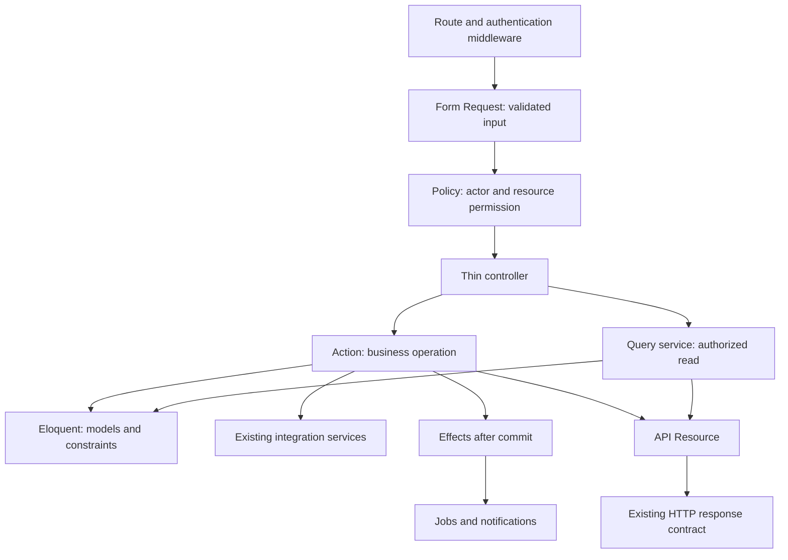
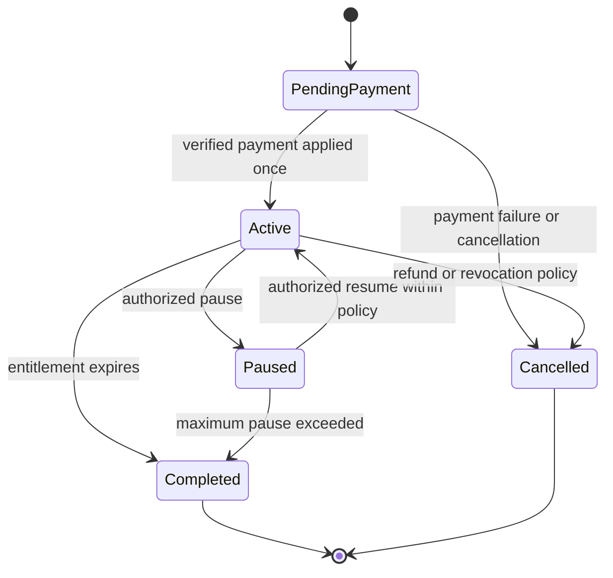

# Architecture improvement proposal

Date: 2026-11-08. Proposal only; no application classes or routes were changed by this review.

Related: [defect audit](PROJECT_CODE_AUDIT.md), [backlog](IMPROVEMENT_BACKLOG.md), [verification](AUDIT_VERIFICATION.md).

## Recommended design

Keep Laravel MVC and Eloquent. Organize business workflows as focused **Actions**, authorization as **Policies**, input as **Form Requests**, reads as **query services/scopes**, and output as **API Resources**. Retain service classes for reusable integrations and calculations. This is a modular monolith with an application service layer, implemented incrementally inside the existing Laravel application.

An Action is an ordinary dependency-injected PHP class representing one business operation, such as `ActivatePaidBoost` or `RestoreAccount`. It does not require another package. Keep ordinary, simple CRUD simple; extract a class when it gives a real transaction, reuse, authorization, or test boundary.



## Why this fits this repository

The repository already uses `ProductBoostPaymentService`, `IndustryDashboardService`, `IndustryAnalyticsService`, `StripeService`, `RevenueCatService`, `IndustryProductResource`, and product/publication Form Requests. Those are useful foundations. The goal is to give each piece one responsibility and make missing safety rules impossible to bypass through another controller.

Do not start with microservices, event sourcing, a generic BaseRepository, a generic BaseService, or interfaces for every class. Eloquent already supplies the persistence abstraction needed for most operations. Introduce an integration contract only when provider substitution or a meaningful test boundary warrants it. Stripe payments and store receipts have different lifecycles: do not force both into a misleading universal `charge()` interface.

## Responsibilities and boundaries

| Component | Owns | Should avoid |
| --- | --- | --- |
| Route/middleware | Authentication, session validity, coarse role gates, throttling | Business writes and domain queries |
| Form Request | Input normalization, limits, conditional validation, policy entry point where appropriate | External payments and persistent side effects |
| Policy | Whether this actor may perform this operation on this resource | Response JSON, network calls, mutating records |
| Controller | Receive validated input, authorize, invoke operation, return status/resource | Transactions, pricing, long query pipelines, duplicated authorization |
| Action | One use case, invariants, transaction boundary, side-effect sequencing | HTTP Request/JsonResponse dependencies, reading the current user globally |
| Query service | Authorized scope, filters, sorting, eager loads, aggregates, pagination | Writes disguised as reads |
| Model | Relationships, casts, small entity behavior and reusable scopes | Request-global state or multi-provider orchestration |
| Resource | Explicit stable output shape from supplied data | Database queries or business decisions |
| Integration service | Provider protocol, timeouts, credentials, normalized failures | Deciding local access rights from unverified client input |
| Job/listener | Retryable asynchronous work, external notifications, media conversion | Captured Request/auth objects or non-idempotent repeated writes |

Pass the actor explicitly to actions and query services. HTTP requests perform policy checks before invoking the operation. Any action also reachable from a command/job must enforce the necessary authorization or document its trusted, already-verified input boundary; a webhook must never be treated as an ordinary logged-in user.

## Suggested organization

These paths are a proposal, not directories created by this review. Obtain the repository-required approval before introducing new base folders such as `app/Actions`, `app/Policies`, or `app/Queries`. If keeping strictly to existing folders initially, place focused operation/query classes under domain subdirectories of `app/Services`.

```text
app/
  Actions/
    Auth/ResetPassword.php
    Auth/RestoreAccount.php
    Auth/IssueAuthenticatedSession.php
    Advertising/StartBoostPurchase.php
    Advertising/ActivatePaidBoost.php
    Advertising/PauseCampaign.php
    Advertising/ResumeCampaign.php
    Social/CreatePost.php
    Social/AddComment.php
    Groups/AcceptGroupInvitation.php
    Jobs/ApplyForJob.php
  Policies/
    IndustryProductPolicy.php
    AdCampaignPolicy.php
    PostPolicy.php
    GroupPolicy.php
    ConversationPolicy.php
    IndustryJobApplicationPolicy.php
  Queries/
    ProductFeedQuery.php
    NewsfeedQuery.php
    RecommendedJobsQuery.php
    CampaignMetricsQuery.php
  Services/
    StripeService.php
    RevenueCatService.php
    Advertising/BoostPricingService.php
    Advertising/ProductBoostProjection.php
    Auth/ChallengeService.php
  Http/
    Controllers/Api/...
    Requests/Advertising/...
    Resources/...
```

Use one naming convention for new Actions, for example verb+noun with `handle()`. Do not mix `execute`, `run`, and invokable styles without a clear project decision. Keep existing public route paths and response envelopes during the extraction. Domain route files can replace contributor-named includes later without changing endpoints.

## Example: product boost lifecycle

Current flow mixes OTP verification, provider selection, purchase, campaign mutation, transaction records, email, and response formatting across `ProductBoostController`, `ProductBoostPaymentService`, `AdCampaign`, and cleanup code.

The target flow is:

1. `PurchaseProductBoostRequest` validates provider-specific input, bounded placements, and package/duration exclusivity. `IndustryProductPolicy::boost` checks actor ownership and entitlement.
2. `StartBoostPurchase` resolves trusted pricing and saves a purchase attempt with a stable idempotency key and immutable package/amount/currency/duration snapshot.
3. The Stripe adapter starts or retrieves the intent using that key. The store-purchase adapter verifies a receipt/transaction against authoritative provider data instead of trusting a client ID.
4. An authenticated webhook or verified client confirmation calls **the same** `ActivatePaidBoost` operation.
5. That operation opens a short DB transaction, locks and reloads the attempt/product/campaign in a consistent order, verifies eligibility and unapplied state, records the payment once, and recalculates the product's effective boost.
6. After commit, dispatch activation notifications. Persist a durable effect/outbox record if losing a notification between commit and dispatch is unacceptable.
7. `PauseCampaign`, `ResumeCampaign`, and scheduled expiry call the same projection logic. They cannot reapply a historical payment.

Suggested lifecycle:



Payment confirmation is a transition out of PendingPayment only. A new purchase creates a new purchase record. Refund and cancellation policy must explicitly state how access, duration, accounting, and campaign history change.

Use integer minor units for payment calculations or a deliberate decimal representation; avoid accumulating float calculations. Preserve provider currency rules and never treat request amounts as authoritative. Store deduplication keys with an appropriate provider/environment namespace and enforce uniqueness in the database, after auditing existing data.

Do not hold a database row lock while waiting for a payment provider. Local DB transactions and provider idempotency solve different failure modes and both are required.

## Example: authentication and recovery

Centralize challenge and session issuance, because the current alternative login endpoints omit different safeguards.

- Password authentication earns a short-lived first-factor challenge when two-factor verification is required.
- Two-factor verification consumes that challenge; it cannot mint a session based on email plus code alone.
- Registration verification proves control of an unverified account; “already verified” never earns a session.
- Password reset and account restoration use independent purpose-bound, expiring proofs. Verification of one purpose cannot authorize another.
- Every session issuance checks suspension/deletion state, records the JWT identifier, and uses the same response resource.
- Every protected request checks session validity regardless of token transport. Test the real middleware with signed JWTs, not just `actingAs`.
- Keep core session creation synchronous. Move optional geolocation and alert enrichment to jobs without making authentication depend on external IP lookup latency.

Purpose-bound challenge storage should include user, purpose, hash, expiration, attempt count, and consumed state. Choose transaction/locking semantics so replay and concurrent consumption cannot both succeed. Rate limits must cover sending and verifying.

## Controller extraction map

| Existing area | First extraction | Shared rule to centralize | Output boundary |
| --- | --- | --- | --- |
| Auth/ForgotPassword/TwoFactor/SecuritySettings/Social | Challenge verification and session issuance | Account status, proof ownership, replay, session revocation | Auth session/account resources |
| ProductBoost/payment service/AdCampaign | Payment application and campaign transitions | One payment credit, owner, duration, product projection | Existing campaign/product resources |
| IndustryController | Company profile operations, company post operations, comment operations | Industry ownership and post visibility | Reusable company/post/comment resources |
| Post/Comment/Like/Timeline/Newsfeed | Create/update/delete post; add comment; feed query | Visibility and actor identity, including company identity | Post/comment/reply resources |
| GroupController | Invite, accept, join, leave, ban actions | Membership status, owner/admin abilities | Group/invitation resources |
| Connection/Follow | Accept/remove connection and follow operations | Pair identity, state transitions, mutual follows | Connection/user summary resources |
| JobsFeedController | Query construction, preference matching, filter parsing | Deterministic matching, bounded pagination | Job card resource |
| IndustryJobPost/Application | Apply and change application status | Recruiter ownership, applicant identity, legal transitions | Job/application resources |
| Conversation/Message and industry variants | Send message and query visible history | Participant access, cleared/deleted visibility, plan access | Message/conversation resources |
| Subscription/billing webhooks | Entitlement evaluation and event application | Provider identity, period validity, event replay | Subscription/transaction resources |
| Admin web/API controllers | Domain operations reused by both adapters | Roles/permissions, protected admin records | Separate web views and API resources |
| Dashboard/analytics services | Named query methods where repeated | Date ranges, timezone, counting definitions | Explicit metrics shapes |

Avoid combining the two messaging models solely because their code looks similar. Share a policy/helper only when personal and industry semantics truly agree. Likewise, keep job matching logic separate from transport pagination.

## Queries, resources, and performance

Queries should return the data that Resources need. Prefer `with`, `withCount`, `withExists`, batched ID maps, and SQL aggregates over lazy queries inside `toArray()`. Reuse the existing optimized product feed queries; do not replace them with generic repository calls that hide their intent.

Give cursor order a deterministic unique tie-breaker. Recommended jobs currently use encoded offsets, while other endpoints use true cursors; document the distinction before changing client behavior. Bound limits and avoid assuming that changing pagination shape is a harmless refactor.

Use query-count regression tests for the specific ad-selection and resource paths identified in the audit. Add indexes only after reading the actual schema and measuring representative query plans. Do not cache user-specific output under shared keys without including every relevant authorization/filter dimension.

## Files, events, jobs, and Octane

Database rollback does not undo filesystem writes. Stage/store new files, commit their references, and clean old files afterward. On failure, remove newly orphaned files. Media jobs need bounded execution, retries, idempotent output naming, and explicit terminal failure state.

Dispatch effects after commit. Retry safety must be designed around the effect: an email, provider charge, notification record, and transcoded file each need different deduplication. Introduce an outbox only for effects whose delivery guarantee justifies it.

FrankenPHP workers boot once. Pass request data into method calls; never retain a user/request in a singleton. Integration clients must observe the chosen settings refresh/reload policy. Test multiple requests through the same worker for mutable configuration and provider-driver state. Ordinary feature tests rebuild the application and cannot prove all worker-lifetime behavior.

## Migration rules

1. Fix authentication and payment defects first; add tests for the corrected contract.
2. Characterize the current valid response behavior before moving code.
3. Extract one complete operation, including its error and transaction paths.
4. Keep status codes, JSON envelopes, pagination, and route paths unchanged unless a documented defect requires a coordinated client change.
5. Reuse existing services and resources. Split oversized services by use case rather than creating another large service.
6. Run affected tests and scoped Scramble export; add missing real types, not redundant annotations.
7. Run Pint for PHP changes and update the relevant integration guide when the contract intentionally changes.
8. Move the next operation only after the previous one is stable. Keep refactor-only PRs separate from behavior fixes where possible.

## Success criteria

- The critical bypasses and unverified-purchase paths have negative regression tests.
- Controllers coordinate HTTP only; no provider payment creation or manual transaction blocks remain in migrated controllers.
- A policy or explicit trusted boundary protects each migrated operation.
- Webhooks and client callbacks cannot double-apply a purchase.
- Resource serialization performs no additional queries on migrated list endpoints.
- A failed write emits no success notification and leaves no damaged file reference.
- Existing clients retain their supported contracts; API documentation describes those contracts accurately.
- Tests, production build, and strict documentation checks have an agreed green baseline.

Framework guidance consulted via Boost: [authorization](https://github.com/laravel/docs/blob/13.x/authorization.md), [transactions and locking](https://github.com/laravel/docs/blob/13.x/queries.md), [Octane lifecycle](https://github.com/laravel/docs/blob/13.x/octane.md), and [Socialite state behavior](https://github.com/laravel/docs/blob/13.x/socialite.md). Installed package source takes precedence when a search result is less specific.
