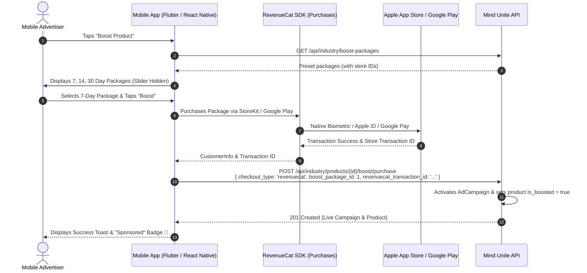

# Mind Unite — Mobile App Developer Advertising & Boosting Integration Guide
## Complete In-App Purchase & Ad Feed Manual for Flutter, React Native, iOS & Android

---

### 1. Mobile Invariants & App Store Policies

To ensure 100% compliance with Apple App Store (StoreKit) and Google Play Billing guidelines, the mobile platform operates under two key rules:

1. **Preset Packages Only (No Custom Slider):**
   - Apple and Google strictly require pre-registered Store SKUs (In-App Purchase products).
   - Dynamic price sliders (choosing arbitrary days like 11 or 17 days) are **prohibited on mobile**.
   - The backend returns `custom_slider.channel = "web_only"`. Mobile apps **must hide the custom slider tab** and display only preset packages.
   - If a mobile client sends `custom_days` with `checkout_type: "revenuecat"`, the backend returns `422 Unprocessable Content`.

2. **Zero Email OTP for Mobile:**
   - Unlike web card checkout, mobile store purchases are already cryptographically secured by Apple FaceID/TouchID or Google Play biometric authentication.
   - Mobile apps **do NOT call `/boost/send-otp`**. The backend completely bypasses email OTP when `checkout_type == 'revenuecat'`.

---

### 2. Store Identifiers & RevenueCat Mapping

Ensure your App Store Connect and Google Play Console in-app products match these configured identifiers:

| Package | Duration | Price | iOS Product ID (StoreKit) | Android Product ID (Play) | RevenueCat Entitlement | Backend Package ID |
| :--- | :--- | :--- | :--- | :--- | :--- | :--- |
| **7-Day Starter** | 7 Days | $19.99 | `boost_product_7d` | `boost_product_7d_gp` | `product_boost_7d` | `1` |
| **14-Day Growth** | 14 Days | $34.99 | `boost_product_14d` | `boost_product_14d_gp` | `product_boost_14d` | `2` |
| **30-Day Pro** | 30 Days | $69.99 | `boost_product_30d` | `boost_product_30d_gp` | `product_boost_30d` | `3` |

---

### 3. Mobile In-App Purchase Sequence Diagram



---

### 4. API Endpoints & Request/Response Payloads

#### 4.1 Fetch Boost Packages
```http
GET /api/industry/boost-packages?target_entity=product
Authorization: Bearer <JWT_USER_TOKEN>
```
**Response (200 OK):**
```json
{
  "success": true,
  "data": {
    "preset_packages": [
      {
        "id": 1,
        "name": "7-Day Starter Boost",
        "duration_days": 7,
        "price": 19.99,
        "estimated_impressions": "5,000 – 10,000 Views",
        "badge": "Popular",
        "description": "Essential visibility for new products.",
        "features": [
          "Top ranking in Marketplace Feed",
          "Sponsored card placement in Social Newsfeed",
          "Real-time impression & click analytics"
        ],
        "revenuecat_product_id": "boost_product_7d",
        "revenuecat_store_identifier_ios": "boost_product_7d",
        "revenuecat_store_identifier_android": "boost_product_7d_gp",
        "revenuecat_entitlement": "product_boost_7d",
        "status": "active"
      },
      {
        "id": 2,
        "name": "14-Day Growth Boost",
        "duration_days": 14,
        "price": 34.99,
        "estimated_impressions": "15,000 – 25,000 Views",
        "badge": "Best Value",
        "revenuecat_product_id": "boost_product_14d",
        "revenuecat_store_identifier_ios": "boost_product_14d",
        "revenuecat_store_identifier_android": "boost_product_14d_gp"
      },
      {
        "id": 3,
        "name": "30-Day Pro Boost",
        "duration_days": 30,
        "price": 69.99,
        "estimated_impressions": "40,000 – 60,000 Views",
        "badge": "Top Reach",
        "revenuecat_product_id": "boost_product_30d",
        "revenuecat_store_identifier_ios": "boost_product_30d",
        "revenuecat_store_identifier_android": "boost_product_30d_gp"
      }
    ],
    "custom_slider": {
      "enabled": true,
      "channel": "web_only"
    }
  }
}
```
> [!IMPORTANT]
> **Check `custom_slider.channel`:** When `channel === "web_only"`, do NOT show a custom days slider in the mobile app. Only display the preset package cards.

#### 4.2 Activate Boost after RevenueCat Purchase
After native In-App Purchase completes, call this endpoint immediately:

```http
POST /api/industry/products/{productId}/boost/purchase
Content-Type: application/json
Authorization: Bearer <JWT_USER_TOKEN>
```
**Request Body:**
```json
{
  "checkout_type": "revenuecat",
  "boost_package_id": 1,
  "revenuecat_transaction_id": "rc_transaction_987654321",
  "network_type": "both",
  "placements": ["marketplace", "newsfeed"]
}
```

**Success Response (201 Created):**
```json
{
  "success": true,
  "message": "Product boosted successfully via RevenueCat in-app purchase.",
  "data": {
    "campaign": {
      "id": 18,
      "boostable_type": "App\\Models\\IndustryProduct",
      "boostable_id": 42,
      "boost_package_id": 1,
      "ad_type": "product",
      "network_type": "both",
      "amount_paid": "19.99",
      "currency": "USD",
      "duration_days": 7,
      "starts_at": "2026-10-15T15:45:00.000000Z",
      "ends_at": "2026-10-22T15:45:00.000000Z",
      "status": "active",
      "total_impressions": 0,
      "total_clicks": 0
    },
    "product": {
      "id": 42,
      "product_name": "BCI Wireless Headset Pro",
      "is_boosted": true,
      "boost_expires_at": "2026-10-22T15:45:00.000000Z",
      "boost_score": 1
    }
  }
}
```

---

### 5. Flutter Implementation Example

#### 5.1 Boost Purchase Service (Flutter / Dart)
```dart
import 'dart:convert';
import 'package:http/http.dart' as http;
import 'package:purchases_flutter/purchases_flutter.dart';

class ProductBoostService {
  final String baseUrl = 'https://api.mindunite.com/api';
  final String userToken;

  ProductBoostService({required this.userToken});

  // Step 1: Buy package via RevenueCat & Activate on Backend
  Future<bool> purchaseAndActivateBoost({
    required int productId,
    required int boostPackageId,
    required String revenueCatStoreId, // e.g. 'boost_product_7d'
  }) async {
    try {
      // 1. Fetch RevenueCat Offerings
      Offerings offerings = await Purchases.getOfferings();
      Package? packageToBuy;

      for (var offering in offerings.all.values) {
        for (var pkg in offering.availablePackages) {
          if (pkg.storeProduct.identifier == revenueCatStoreId) {
            packageToBuy = pkg;
            break;
          }
        }
      }

      if (packageToBuy == null) {
        throw Exception("Store package not found in RevenueCat offerings.");
      }

      // 2. Perform Native StoreKit / Google Play Purchase
      CustomerInfo customerInfo = await Purchases.purchasePackage(packageToBuy);
      String transactionId = customerInfo.originalAppUserId; // or active transaction id

      // 3. Post to Mind Unite Backend (NO OTP NEEDED)
      final response = await http.post(
        Uri.parse('$baseUrl/industry/products/$productId/boost/purchase'),
        headers: {
          'Content-Type': 'application/json',
          'Accept': 'application/json',
          'Authorization': 'Bearer $userToken',
        },
        body: jsonEncode({
          'checkout_type': 'revenuecat',
          'boost_package_id': boostPackageId,
          'revenuecat_transaction_id': transactionId,
          'network_type': 'both',
          'placements': ['marketplace', 'newsfeed'],
        }),
      );

      if (response.statusCode == 201 || response.statusCode == 200) {
        return true;
      } else {
        print("Backend activation failed: ${response.body}");
        return false;
      }
    } catch (e) {
      print("Purchase error: $e");
      return false;
    }
  }
}
```

---

### 6. Newsfeed Timeline & Sponsored Card Display (Mobile)

In `/api/newsfeed`, sponsored cards appear every 4–8 posts. The mobile app must render them with a **"Sponsored"** badge.

#### 6.1 Feed Card Model
```dart
class FeedItem {
  final dynamic id;
  final bool isSponsored;
  final int? adCampaignId;
  final String? title;
  final String? description;
  final String? imageUrl;
  final double? price;
  final String? destinationUrl;
  final String? ctaText;
  final String? companyName;
  final String? companyLogo;
  final String? badge;

  FeedItem({
    required this.id,
    this.isSponsored = false,
    this.adCampaignId,
    this.title,
    this.description,
    this.imageUrl,
    this.price,
    this.destinationUrl,
    this.ctaText,
    this.companyName,
    this.companyLogo,
    this.badge,
  });

  factory FeedItem.fromJson(Map<String, dynamic> json) {
    if (json['is_sponsored'] == true) {
      return FeedItem(
        id: json['id'],
        isSponsored: true,
        adCampaignId: json['ad_campaign_id'],
        title: json['title'],
        description: json['description'],
        imageUrl: json['image'],
        price: json['price'] != null ? double.tryParse(json['price'].toString()) : null,
        destinationUrl: json['destination_url'],
        ctaText: json['cta_text'] ?? 'View Product',
        companyName: json['company']?['name'],
        companyLogo: json['company']?['logo'],
        badge: json['badge'] ?? 'Sponsored',
      );
    }
    // Normal Post parsing...
    return FeedItem(
      id: json['id'],
      isSponsored: false,
      description: json['description'],
    );
  }
}
```

#### 6.2 Viewport Impression & Click Tracking (Flutter)
Use the `visibility_detector` package to report verified IAB viewable impressions:

```dart
import 'package:flutter/material.dart';
import 'package:visibility_detector/visibility_detector.dart';
import 'package:http/http.dart' as http;
import 'package:url_launcher/url_launcher.dart';

class SponsoredProductWidget extends StatefulWidget {
  final FeedItem ad;
  final String? userToken;

  const SponsoredProductWidget({Key? key, required this.ad, this.userToken}) : super(key: key);

  @override
  State<SponsoredProductWidget> createState() => _SponsoredProductWidgetState();
}

class _SponsoredProductWidgetState extends State<SponsoredProductWidget> {
  bool _impressionLogged = false;

  void _onVisibilityChanged(VisibilityInfo info) {
    // IAB Standard: 50% visible
    if (!_impressionLogged && info.visibleFraction >= 0.5) {
      _impressionLogged = true;
      Future.delayed(const Duration(seconds: 1), () {
        // Send verified viewable impression to backend
        http.post(
          Uri.parse('https://api.mindunite.com/api/advertisements/impressions'),
          headers: {'Content-Type': 'application/json'},
          body: jsonEncode({
            'campaign_ids': [widget.ad.adCampaignId],
            'placement': 'newsfeed',
          }),
        );
      });
    }
  }

  Future<void> _handleAdClick() async {
    try {
      final res = await http.post(
        Uri.parse('https://api.mindunite.com/api/advertisements/${widget.ad.adCampaignId}/click'),
        headers: {'Content-Type': 'application/json'},
        body: jsonEncode({'placement': 'newsfeed'}),
      );
      final data = jsonDecode(res.body);
      final destUrl = data['data']?['destination_url'] ?? widget.ad.destinationUrl;
      if (destUrl != null) {
        await launchUrl(Uri.parse(destUrl), mode: LaunchMode.externalApplication);
      }
    } catch (_) {
      if (widget.ad.destinationUrl != null) {
        await launchUrl(Uri.parse(widget.ad.destinationUrl!));
      }
    }
  }

  @override
  Widget build(BuildContext context) {
    return VisibilityDetector(
      key: Key('ad_${widget.ad.adCampaignId}'),
      onVisibilityChanged: _onVisibilityChanged,
      child: Container(
        margin: const EdgeInsets.symmetric(vertical: 8, horizontal: 16),
        padding: const EdgeInsets.all(16),
        decoration: BoxDecoration(
          color: Colors.white,
          borderRadius: BorderRadius.circular(16),
          border: Border.all(color: const Color(0xFFE2E8F0)),
        ),
        child: Column(
          crossAxisAlignment: CrossAxisAlignment.start,
          children: [
            Row(
              mainAxisAlignment: MainAxisAlignment.spaceBetween,
              children: [
                Text(widget.ad.companyName ?? '', style: const TextStyle(fontWeight: FontWeight.bold)),
                Chip(
                  label: Text(widget.ad.badge ?? 'Sponsored', style: const TextStyle(fontSize: 10, color: Color(0xFF043940))),
                  backgroundColor: const Color(0xFFE6FFFA),
                ),
              ],
            ),
            if (widget.ad.imageUrl != null)
              ClipRRect(
                borderRadius: BorderRadius.circular(12),
                child: Image.network(widget.ad.imageUrl!, height: 180, width: double.infinity, fit: BoxFit.cover),
              ),
            const SizedBox(height: 8),
            Text(widget.ad.title ?? '', style: const TextStyle(fontSize: 16, fontWeight: FontWeight.bold)),
            const SizedBox(height: 12),
            ElevatedButton(
              style: ElevatedButton.styleFrom(backgroundColor: const Color(0xFF043940)),
              onPressed: _handleAdClick,
              child: Text(widget.ad.ctaText ?? 'View Product'),
            ),
          ],
        ),
      ),
    );
  }
}
```

---

### 7. Campaign Pause & Resume Controls on Mobile

Advertisers can pause campaigns and resume them anytime without forfeiting paid days:
- **Pause Campaign:** `POST /api/industry/boost/campaigns/{id}/pause`
- **Resume Campaign:** `POST /api/industry/boost/campaigns/{id}/resume`
- **Campaign Analytics:** `GET /api/industry/products/{id}/boost/campaigns`
