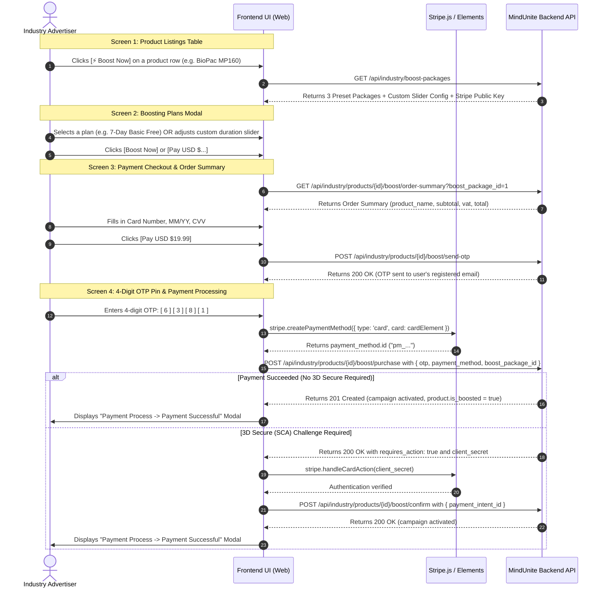

# MindUnite Pro Industry — Product Boost Web Integration Guide
> **Version:** 2.0 (Aligined with 4-Screen Purchase Flow)  
> **Author:** MindUnite Backend Engineering Team  
> **Target Audience:** Frontend Web Developers (React, Next.js, Vue, Angular)

---

## 🗺️ Complete 4-Screen Purchase Flow Overview



---

## 🔑 Authentication & Base Configuration

All requests in this guide are authenticated with the user's JWT access token:

```http
Authorization: Bearer <AUTH_TOKEN>
Accept: application/json
Content-Type: application/json
```

---

## 📦 TypeScript Data Interfaces

Copy and paste these interfaces into your frontend project (e.g. `src/types/boosting.ts`):

```typescript
// Preset Boost Packages
export interface BoostPackage {
  id: number;
  name: string;
  duration_days: number;
  price: number;
  daily_price: number;
  estimated_impressions: string;
  badge: string; // e.g. "Basic Free", "Most Popular Plan", "Best Value"
  features: string[];
  status: 'active' | 'inactive';
}

// Custom Duration Slider
export interface CustomSliderConfig {
  enabled: boolean;
  daily_rate: number; // e.g. 3.00
  min_days: number;   // e.g. 3
  max_days: number;   // e.g. 60
  daily_estimated_impressions: string;
}

// Packages API Response
export interface BoostPackagesResponse {
  success: boolean;
  data: {
    stripe_public_key: string;
    preset_packages: BoostPackage[];
    custom_slider: CustomSliderConfig;
  };
}

// Order Summary (Screen 3 & Screen 4)
export interface OrderSummary {
  product_id: string;          // e.g. "10XEYC"
  product_name: string;        // e.g. "BioPac MP160"
  product_image: string | null;
  plan_title: string;          // e.g. "Basic Free Boosting" or "Custom Boosting (20 Days)"
  duration_days: number;       // e.g. 7
  duration_text: string;       // e.g. "7 Days"
  estimated_impressions: string; // e.g. "Est. 5k – 10k Impression"
  subtotal: number;            // e.g. 19.99
  subtotal_formatted: string;  // e.g. "$19.99"
  vat: number;                 // e.g. 0.00
  vat_formatted: string;       // e.g. "$0.00"
  total: number;               // e.g. 19.99
  total_formatted: string;     // e.g. "$19.99"
  currency: string;            // "USD"
}

// Send OTP Response
export interface SendOtpResponse {
  success: boolean;
  message: string;
  data: {
    email: string;
    requires_verification: boolean;
    product: {
      id: number;
      product_id: string;
      product_name: string;
      image_url: string | null;
    };
    order_summary: OrderSummary;
  };
}

// Purchase Success Response
export interface PurchaseBoostSuccessResponse {
  success: boolean;
  message: string;
  data: {
    requires_action: false;
    campaign: {
      id: number;
      boostable_id: number;
      ad_type: 'product';
      amount_paid: string | number;
      duration_days: number;
      status: 'active';
      starts_at: string;
      ends_at: string;
    };
    product: {
      id: number;
      product_name: string;
      is_boosted: boolean;
      boost_days_left: number;
      boost_remaining_text: string; // e.g. "7 days left"
    };
  };
}

// 3D Secure Action Response
export interface PurchaseRequiresActionResponse {
  success: boolean;
  message: string;
  data: {
    requires_action: true;
    payment_intent_client_secret: string;
    payment_status: 'requires_action';
    campaign_id: number;
  };
}
```

---

## 🖥️ Screen-by-Screen Implementation Guide

---

### Screen 1: Your Product Listings (`Pro Industry Dashboard >> Products`)

Displays the advertiser's products table with impressions, clicks, status, and boost remaining tags.

#### 1.1 API Details
* **Method:** `GET`
* **URL:** `/api/industry/products/my-listings`
* **Query Parameters:**
  | Parameter | Type | Default | Description |
  |:---|:---|:---|:---|
  | `page` | `number` | `1` | Pagination page number |
  | `per_page` | `number` | `10` | Records per page (Max: 100) |
  | `status` | `string` | optional | Filter by `active`, `inactive`, `paused`, `cancel` |
  | `search` | `string` | optional | Filter by product name or 6-digit ID |

#### 1.2 Response Sample (200 OK)
```json
{
  "success": true,
  "message": "Products retrieved successfully.",
  "stats": {
    "total_products": 56,
    "total_active_products": 56,
    "total_impressions": 4578890,
    "total_clicks": 67895
  },
  "data": [
    {
      "id": 2,
      "product_id": "10XEYC",
      "product_name": "BioPac MP160",
      "slug": "biopac-mp160-kwc0qb",
      "image_url": "https://mindunite.org/storage/products/biopac.jpg",
      "network_type": "psychology",
      "industry_type": "biotech",
      "status": "active",
      "impressions_count": 45675,
      "clicks_count": 6864,
      "is_boosted": true,
      "boost_days_left": 7,
      "boost_remaining_text": "7 days left"
    },
    {
      "id": 5,
      "product_id": "22YABC",
      "product_name": "Cognitive Tracker Pro",
      "slug": "cognitive-tracker-pro-abc",
      "image_url": "https://mindunite.org/storage/products/cog.jpg",
      "network_type": "neuroscience",
      "industry_type": "biotech",
      "status": "active",
      "impressions_count": 1240,
      "clicks_count": 89,
      "is_boosted": false,
      "boost_days_left": null,
      "boost_remaining_text": null
    }
  ],
  "pagination": {
    "current_page": 1,
    "per_page": 10,
    "total": 56,
    "last_page": 6,
    "has_more_pages": true
  }
}
```

#### 1.3 UI Rendering Rules
1. **Top Metric Cards:**
   * `All Products` = `stats.total_products`
   * `Active Products` = `stats.total_active_products`
   * `Total Impression` = `stats.total_impressions.toLocaleString()`
   * `Total Click` = `stats.total_clicks.toLocaleString()`
2. **Action Column:**
   * If `row.is_boosted === true`: Render purple badge with lightning bolt: `⚡ {row.boost_remaining_text}` (e.g. `⚡ 7 days Left`).
   * If `row.is_boosted === false`: Render `[ ⚡ Boost Now ]` button.
3. **Trigger:** Clicking `[ ⚡ Boost Now ]` saves the selected product and opens **Screen 2 (Boosting Plans Modal)**.

---

### Screen 2: Boosting Plans Modal (`Boosting Plans`)

Displays 3 preset cards and the Custom Boosting duration slider.

#### 2.1 API Details
* **Method:** `GET`
* **URL:** `/api/industry/boost-packages`

#### 2.2 Response Sample (200 OK)
```json
{
  "success": true,
  "data": {
    "stripe_public_key": "pk_test_51UDHbqRBaxaeUOx4iA0SJjMfYNhUCOc6eZXJIvsK0WdWZBfBULPlIwsMdNk8KoaIsd7pIE1uvt8ucm6v4KJ68OSG00UZwpRkGE",
    "preset_packages": [
      {
        "id": 1,
        "name": "Starter Boost",
        "duration_days": 7,
        "price": 19.99,
        "daily_price": 2.86,
        "estimated_impressions": "5k – 10k Impression",
        "badge": "Basic Free",
        "features": [
          "Basic analytics",
          "Up to 5,000 impressions",
          "Standard placement",
          "Email support"
        ]
      },
      {
        "id": 2,
        "name": "Growth Boost",
        "duration_days": 14,
        "price": 34.99,
        "daily_price": 2.50,
        "estimated_impressions": "15k – 25k Impression",
        "badge": "Most Popular Plan",
        "features": [
          "Up to 15,000 impressions",
          "Targeted industry & location",
          "Featured placement",
          "Detailed analytics",
          "Priority support"
        ]
      },
      {
        "id": 3,
        "name": "Best Value",
        "duration_days": 30,
        "price": 69.99,
        "daily_price": 2.33,
        "estimated_impressions": "100k – 200k Impression",
        "badge": "Best Value",
        "features": [
          "Up to 100,000 impressions",
          "Advanced targeting (industry, location, role, size)",
          "Premium placement (homepage & category)",
          "Full analytics & reporting",
          "Dedicated support"
        ]
      }
    ],
    "custom_slider": {
      "enabled": true,
      "daily_rate": 3.00,
      "min_days": 3,
      "max_days": 60,
      "daily_estimated_impressions": "3,500 – 6,000 views/day"
    }
  }
}
```

#### 2.3 UI Interaction Rules
1. Initialize Stripe Elements with `stripe_public_key`.
2. Map `preset_packages` to the 3 card columns.
3. Custom slider uses `custom_slider.min_days` (3) to `custom_slider.max_days` (60).
   * Total price = `sliderDays * custom_slider.daily_rate` ($3.00).
   * Example: 20 Days = `$3.00 x 20 Days = $60.00 Total`.
4. Clicking `[ Boost Now ]` on a preset card or `[ Pay USD $... ]` on the custom slider opens **Screen 3 (Payment Checkout)**.

---

### Screen 3: Payment Checkout & Order Summary

Contains the Stripe card input on the left and the **Order Summary (with Product Name)** on the right.

```
+--------------------------------------------------------------------------------------------------------+
| Payment                                            | Order Summary                                     |
|                                                    |                                                   |
| Card Number: [ 1234 5676 2324 3565       💳 ]      | [Img] BioPac MP160 (ID: 10XEYC)                   |
| Expiration Date: [ MM/YY ]    CVV: [ 321 ]         | Plan: Basic Free Boosting (7 Days)        $19.99  |
| [X] Save card details                              | Est. 5k – 10k Impression                          |
|                                                    | ------------------------------------------------- |
| [ Pay USD $19.99 ]                                 | Subtotal                                  $19.99  |
|                                                    | VAT                                        $0.00  |
|                                                    | Total                                     $19.99  |
+--------------------------------------------------------------------------------------------------------+
```

#### 3.1 Order Summary Preview Endpoint (Before Paying)
Call this endpoint to fetch the exact Order Summary for the product:
* **Method:** `GET`
* **URL:** `/api/industry/products/{product_id}/boost/order-summary`
* **Query Parameters:**
  * For preset package: `?boost_package_id=1`
  * For custom slider: `?custom_days=20`

**Response Sample (200 OK):**
```json
{
  "success": true,
  "message": "Order summary calculated successfully.",
  "data": {
    "product": {
      "id": 2,
      "product_id": "10XEYC",
      "product_name": "BioPac MP160",
      "slug": "biopac-mp160-kwc0qb",
      "image_url": "https://mindunite.org/storage/products/biopac.jpg"
    },
    "order_summary": {
      "product_id": "10XEYC",
      "product_name": "BioPac MP160",
      "product_image": "https://mindunite.org/storage/products/biopac.jpg",
      "plan_title": "Basic Free Boosting",
      "duration_days": 7,
      "duration_text": "7 Days",
      "estimated_impressions": "Est. 5k – 10k Impression",
      "subtotal": 19.99,
      "subtotal_formatted": "$19.99",
      "vat": 0.00,
      "vat_formatted": "$0.00",
      "total": 19.99,
      "total_formatted": "$19.99",
      "currency": "USD"
    }
  }
}
```

#### 3.2 Action: User Clicks `[ Pay USD $19.99 ]` (Trigger OTP)
Validate that card details are filled in Stripe Elements, then dispatch OTP to user's email:

* **Method:** `POST`
* **URL:** `/api/industry/products/{product_id}/boost/send-otp`
* **Headers:** `Authorization: Bearer <AUTH_TOKEN>`, `Content-Type: application/json`
* **Request Body (Preset Package):**
  ```json
  {
    "boost_package_id": 1
  }
  ```
* **Request Body (Custom Slider):**
  ```json
  {
    "custom_days": 20
  }
  ```

**Response Sample (200 OK):**
```json
{
  "success": true,
  "message": "OTP sent to your email. Submit the request again with the OTP and payment method to complete the boost.",
  "data": {
    "email": "user@company.com",
    "requires_verification": true,
    "product": {
      "id": 2,
      "product_id": "10XEYC",
      "product_name": "BioPac MP160",
      "image_url": "https://mindunite.org/storage/products/biopac.jpg"
    },
    "order_summary": {
      "product_id": "10XEYC",
      "product_name": "BioPac MP160",
      "plan_title": "Basic Free Boosting",
      "duration_days": 7,
      "duration_text": "7 Days",
      "estimated_impressions": "Est. 5k – 10k Impression",
      "subtotal": 19.99,
      "subtotal_formatted": "$19.99",
      "vat": 0.00,
      "vat_formatted": "$0.00",
      "total": 19.99,
      "total_formatted": "$19.99",
      "currency": "USD"
    }
  }
}
```

* On success, transition to **Screen 4 (OTP Pin Input)**.

---

### Screen 4: 4-Digit OTP Verification & Payment Processing

Displays 4 digit input boxes: `[ 6 ] [ 3 ] [ 8 ] [ 1 ]`.

#### 4.1 Step 1: Tokenize Card via Stripe Elements
```javascript
const { paymentMethod, error } = await stripe.createPaymentMethod({
  type: 'card',
  card: cardElement,
});

if (error) {
  // Show error under card inputs
  return;
}
```

#### 4.2 Step 2: Submit OTP & Charge Payment
* **Method:** `POST`
* **URL:** `/api/industry/products/{product_id}/boost/purchase`
* **Headers:** `Authorization: Bearer <AUTH_TOKEN>`, `Content-Type: application/json`
* **Request Body (Preset Package):**
  ```json
  {
    "boost_package_id": 1,
    "otp": "6381",
    "payment_method": "pm_card_visa"
  }
  ```
* **Request Body (Custom Slider):**
  ```json
  {
    "custom_days": 20,
    "otp": "6381",
    "payment_method": "pm_card_visa"
  }
  ```

#### 4.3 Resending OTP (60-Second Cooldown Timer)
If the advertiser did not receive the email OTP or if the code expired, the frontend can request a new OTP:
* **Method:** `POST`
* **URL:** `/api/industry/products/{product_id}/boost/resend-otp`
* **Request Body:**
  ```json
  {
    "boost_package_id": 1
  }
  ```

**Success Response (200 OK):**
```json
{
  "success": true,
  "message": "OTP sent to your email. Submit the request again with the OTP and payment method to complete the boost.",
  "data": {
    "email": "user@company.com",
    "requires_verification": true,
    "cooldown_seconds": 60
  }
}
```

**Cooldown Active Response (429 Too Many Requests):**
If the user clicks "Resend" before 60 seconds have elapsed, the backend returns:
```json
{
  "success": false,
  "message": "Please wait 42 seconds before requesting a new OTP.",
  "data": {
    "retry_after": 42
  }
}
```
*Frontend rule:* Display a 60-second countdown timer `Resend code in 00:59` under the 4 OTP boxes. Only enable the "Resend OTP" button when the timer reaches 0.

#### 4.3 Standard Success Response (201 Created)
When the card is charged successfully:
```json
{
  "success": true,
  "message": "Product boosted successfully! Your campaign is now live.",
  "data": {
    "requires_action": false,
    "campaign": {
      "id": 12,
      "boostable_id": 2,
      "ad_type": "product",
      "network_type": "psychology",
      "amount_paid": "19.99",
      "duration_days": 7,
      "status": "active",
      "starts_at": "2026-10-26T11:00:00.000000Z",
      "ends_at": "2026-11-02T11:00:00.000000Z"
    },
    "product": {
      "id": 2,
      "product_name": "BioPac MP160",
      "is_boosted": true,
      "boost_days_left": 7,
      "boost_remaining_text": "7 days left"
    }
  }
}
```

#### 4.4 3D Secure (SCA) Response & Confirm Flow
If the card bank requires 3D Secure authentication:
```json
{
  "success": true,
  "message": "Additional authentication is required to complete your payment.",
  "data": {
    "requires_action": true,
    "payment_intent_client_secret": "pi_3MtwLw2eZvKYlo2C0VvX7Y_secret_xyz",
    "payment_status": "requires_action",
    "campaign_id": 12
  }
}
```

**Handling 3D Secure in Frontend:**
```javascript
// 1. Let Stripe open the bank's authentication modal
const { paymentIntent, error } = await stripe.handleCardAction(
  response.data.payment_intent_client_secret
);

if (error) {
  alert(error.message);
  return;
}

// 2. Confirm the payment with the backend
const confirmResponse = await fetch(`/api/industry/products/${productId}/boost/confirm`, {
  method: 'POST',
  headers: {
    'Authorization': `Bearer ${token}`,
    'Content-Type': 'application/json'
  },
  body: JSON.stringify({
    payment_intent_id: paymentIntent.id
  })
});
```

#### 4.5 Success Modal
Once payment succeeds, render the Screen 4 modal:
```
+---------------------------------------+
| Payment Process                   [X] |
|                                       |
|                ( ✔ )                  |
|          Payment Successful           |
|                                       |
+---------------------------------------+
```

---

## 💻 Complete React / Next.js Component Example

```tsx
import React, { useState, useEffect } from 'react';
import { loadStripe } from '@stripe/stripe-js';
import { CardElement, useStripe, useElements } from '@stripe/react-stripe-js';
import type { BoostPackagesResponse, OrderSummary } from './types/boosting';

interface BoostModalProps {
  productId: number;
  onClose: () => void;
  onSuccess: () => void;
}

export const BoostModal: React.FC<BoostModalProps> = ({ productId, onClose, onSuccess }) => {
  const stripe = useStripe();
  const elements = useElements();

  const [step, setStep] = useState<1 | 2 | 3 | 4>(1); // 1: Plans, 2: Checkout, 3: OTP, 4: Success
  const [packagesData, setPackagesData] = useState<BoostPackagesResponse['data'] | null>(null);
  const [selectedPackageId, setSelectedPackageId] = useState<number | null>(1);
  const [customDays, setCustomDays] = useState<number>(20);
  const [isCustom, setIsCustom] = useState<boolean>(false);
  const [orderSummary, setOrderSummary] = useState<OrderSummary | null>(null);
  const [otp, setOtp] = useState<string>('');
  const [loading, setLoading] = useState<boolean>(false);
  const [errorMsg, setErrorMsg] = useState<string>('');

  // 1. Fetch Packages on Load
  useEffect(() => {
    fetch('/api/industry/boost-packages', {
      headers: { Authorization: `Bearer ${localStorage.getItem('token')}` }
    })
      .then(res => res.json())
      .then(data => setPackagesData(data.data));
  }, []);

  // 2. Transition from Plans to Checkout (Fetch Order Summary with Product Name)
  const handleSelectPlan = async (packageId: number | null, days: number | null) => {
    setLoading(true);
    try {
      const query = packageId ? `boost_package_id=${packageId}` : `custom_days=${days}`;
      const res = await fetch(`/api/industry/products/${productId}/boost/order-summary?${query}`, {
        headers: { Authorization: `Bearer ${localStorage.getItem('token')}` }
      });
      const data = await res.json();
      setOrderSummary(data.data.order_summary);
      setStep(2); // Go to Screen 3 (Payment Checkout)
    } finally {
      setLoading(false);
    }
  };

  // 3. User Clicks [ Pay USD $... ] -> Send OTP
  const [timer, setTimer] = useState<number>(60);
  const [canResend, setCanResend] = useState<boolean>(false);

  useEffect(() => {
    let interval: any;
    if (step === 3 && timer > 0) {
      interval = setInterval(() => setTimer(t => t - 1), 1000);
    } else if (timer === 0) {
      setCanResend(true);
    }
    return () => clearInterval(interval);
  }, [step, timer]);

  const handleSendOtp = async () => {
    setLoading(true);
    setErrorMsg('');
    try {
      const payload = isCustom ? { custom_days: customDays } : { boost_package_id: selectedPackageId };
      const res = await fetch(`/api/industry/products/${productId}/boost/send-otp`, {
        method: 'POST',
        headers: {
          Authorization: `Bearer ${localStorage.getItem('token')}`,
          'Content-Type': 'application/json'
        },
        body: JSON.stringify(payload)
      });
      const data = await res.json();
      if (!res.ok) {
        setErrorMsg(data.message);
        return;
      }
      setTimer(60);
      setCanResend(false);
      setStep(3); // Go to Screen 4 (OTP Pin Input)
    } finally {
      setLoading(false);
    }
  };

  // 4. Resend OTP with 60s cooldown
  const handleResendOtp = async () => {
    if (!canResend) return;
    setLoading(true);
    setErrorMsg('');
    try {
      const payload = isCustom ? { custom_days: customDays } : { boost_package_id: selectedPackageId };
      const res = await fetch(`/api/industry/products/${productId}/boost/resend-otp`, {
        method: 'POST',
        headers: {
          Authorization: `Bearer ${localStorage.getItem('token')}`,
          'Content-Type': 'application/json'
        },
        body: JSON.stringify(payload)
      });
      const data = await res.json();
      if (!res.ok) {
        setErrorMsg(data.message);
        return;
      }
      setTimer(60);
      setCanResend(false);
    } finally {
      setLoading(false);
    }
  };

  // 4. User Submits OTP & Confirms Payment
  const handleConfirmPurchase = async () => {
    if (!stripe || !elements || otp.length !== 4) return;
    setLoading(true);
    setErrorMsg('');

    try {
      // Create Stripe PaymentMethod from CardElement
      const cardEl = elements.getElement(CardElement);
      if (!cardEl) return;
      const { paymentMethod, error: stripeErr } = await stripe.createPaymentMethod({
        type: 'card',
        card: cardEl
      });

      if (stripeErr) {
        setErrorMsg(stripeErr.message || 'Card validation failed');
        return;
      }

      // Submit purchase request
      const payload = isCustom
        ? { custom_days: customDays, otp, payment_method: paymentMethod.id }
        : { boost_package_id: selectedPackageId, otp, payment_method: paymentMethod.id };

      const res = await fetch(`/api/industry/products/${productId}/boost/purchase`, {
        method: 'POST',
        headers: {
          Authorization: `Bearer ${localStorage.getItem('token')}`,
          'Content-Type': 'application/json'
        },
        body: JSON.stringify(payload)
      });
      const data = await res.json();

      if (!res.ok) {
        setErrorMsg(data.message);
        return;
      }

      // Check if 3D Secure is required
      if (data.data?.requires_action) {
        const { paymentIntent, error: actionErr } = await stripe.handleCardAction(
          data.data.payment_intent_client_secret
        );
        if (actionErr) {
          setErrorMsg(actionErr.message || '3DS verification failed');
          return;
        }

        // Confirm 3DS with backend
        await fetch(`/api/industry/products/${productId}/boost/confirm`, {
          method: 'POST',
          headers: {
            Authorization: `Bearer ${localStorage.getItem('token')}`,
            'Content-Type': 'application/json'
          },
          body: JSON.stringify({ payment_intent_id: paymentIntent.id })
        });
      }

      setStep(4); // Show Payment Successful Modal!
      onSuccess();
    } finally {
      setLoading(false);
    }
  };

  return (
    <div className="fixed inset-0 bg-black/60 flex items-center justify-center p-4 z-50">
      <div className="bg-white rounded-2xl max-w-2xl w-full p-6 shadow-2xl relative">
        <button onClick={onClose} className="absolute right-4 top-4 text-gray-400 hover:text-gray-600">✕</button>

        {/* STEP 1: Screen 2 (Boosting Plans Modal) */}
        {step === 1 && packagesData && (
          <div>
            <h2 className="text-2xl font-bold">Boosting Plans</h2>
            <p className="text-sm text-gray-500 mb-6">Manage boosting overview features</p>
            
            <div className="grid grid-cols-3 gap-4 mb-6">
              {packagesData.preset_packages.map(pkg => (
                <div key={pkg.id} className="border rounded-xl p-4 flex flex-col justify-between hover:border-teal-500 transition">
                  <div>
                    <span className="text-xs bg-gray-100 text-gray-600 px-2 py-0.5 rounded">{pkg.badge}</span>
                    <h3 className="text-xl font-bold mt-2">${pkg.price} <span className="text-xs text-gray-400 font-normal">/ {pkg.duration_days} Days</span></h3>
                    <p className="text-xs text-teal-600 font-medium my-2 bg-teal-50 p-1 rounded text-center">{pkg.estimated_impressions}</p>
                    <ul className="text-xs text-gray-600 space-y-1">
                      {pkg.features.map((f, i) => <li key={i}>✓ {f}</li>)}
                    </ul>
                  </div>
                  <button 
                    onClick={() => { setIsCustom(false); setSelectedPackageId(pkg.id); handleSelectPlan(pkg.id, null); }}
                    className="w-full mt-4 bg-teal-600 hover:bg-teal-700 text-white py-2 rounded-lg text-sm font-semibold">
                    Boost Now
                  </button>
                </div>
              ))}
            </div>

            {/* Custom Duration Slider */}
            <div className="border-t pt-4">
              <div className="flex justify-between items-center mb-2">
                <span className="font-semibold text-sm">Custom Boosting: {customDays} Days</span>
                <span className="text-xs bg-teal-50 text-teal-600 px-2 py-1 rounded">Est. {customDays * 4}k – {customDays * 7}k Views</span>
              </div>
              <input
                type="range"
                min={packagesData.custom_slider.min_days}
                max={packagesData.custom_slider.max_days}
                value={customDays}
                onChange={e => setCustomDays(Number(e.target.value))}
                className="w-full"
              />
              <div className="flex justify-between items-center mt-3">
                <span className="text-sm text-gray-600">${packagesData.custom_slider.daily_rate.toFixed(2)} × {customDays} Days = ${(customDays * packagesData.custom_slider.daily_rate).toFixed(2)}</span>
                <button
                  onClick={() => { setIsCustom(true); handleSelectPlan(null, customDays); }}
                  className="bg-teal-600 text-white px-6 py-2 rounded-lg text-sm font-semibold">
                  Pay USD ${(customDays * packagesData.custom_slider.daily_rate).toFixed(2)}
                </button>
              </div>
            </div>
          </div>
        )}

        {/* STEP 2: Screen 3 (Payment Checkout & Order Summary with Product Name) */}
        {step === 2 && orderSummary && (
          <div className="grid grid-cols-2 gap-6">
            <div>
              <h3 className="text-lg font-bold mb-4">Payment</h3>
              <div className="border p-3 rounded-lg mb-4">
                <CardElement options={{ style: { base: { fontSize: '15px' } } }} />
              </div>
              {errorMsg && <p className="text-red-500 text-xs mb-3">{errorMsg}</p>}
              <button
                disabled={loading}
                onClick={handleSendOtp}
                className="w-full bg-teal-600 hover:bg-teal-700 text-white py-3 rounded-lg font-semibold">
                {loading ? 'Processing...' : `Pay USD ${orderSummary.total_formatted}`}
              </button>
            </div>

            {/* Order Summary with Product Name */}
            <div className="bg-gray-50 p-4 rounded-xl">
              <h4 className="font-bold text-sm text-gray-700 mb-3">Order Summary</h4>
              <div className="mb-3">
                <p className="font-semibold text-gray-900">{orderSummary.product_name}</p>
                <p className="text-xs text-gray-500">Product ID: {orderSummary.product_id}</p>
                <p className="text-xs text-teal-600 mt-1">{orderSummary.plan_title} • {orderSummary.estimated_impressions}</p>
              </div>
              <div className="border-t pt-2 space-y-1 text-xs text-gray-600">
                <div className="flex justify-between"><span>Subtotal:</span><span>{orderSummary.subtotal_formatted}</span></div>
                <div className="flex justify-between"><span>VAT:</span><span>{orderSummary.vat_formatted}</span></div>
                <div className="flex justify-between font-bold text-sm text-gray-900 pt-1 border-t">
                  <span>Total:</span><span>{orderSummary.total_formatted}</span>
                </div>
              </div>
            </div>
          </div>
        )}

        {/* STEP 3: Screen 4 (4-Digit OTP Pin Input) */}
        {step === 3 && orderSummary && (
          <div className="grid grid-cols-2 gap-6">
            <div>
              <h3 className="text-lg font-bold mb-2">Payment Verification</h3>
              <p className="text-xs text-gray-500 mb-4">Enter your 4-digit OTP pin to confirm this payment</p>
              <input
                type="text"
                maxLength={4}
                value={otp}
                onChange={e => setOtp(e.target.value.replace(/\D/g, ''))}
                placeholder="6 3 8 1"
                className="w-full tracking-widest text-center text-2xl font-bold py-3 border rounded-lg mb-2"
              />
              <div className="flex justify-between items-center text-xs mb-4">
                <span className="text-gray-500">Didn't receive code?</span>
                {canResend ? (
                  <button onClick={handleResendOtp} className="text-teal-600 font-semibold hover:underline">
                    Resend OTP
                  </button>
                ) : (
                  <span className="text-gray-400">Resend in 00:{timer < 10 ? `0${timer}` : timer}</span>
                )}
              </div>
              {errorMsg && <p className="text-red-500 text-xs mb-3">{errorMsg}</p>}
              <button
                disabled={loading || otp.length !== 4}
                onClick={handleConfirmPurchase}
                className="w-full bg-teal-600 hover:bg-teal-700 disabled:opacity-50 text-white py-3 rounded-lg font-semibold">
                {loading ? 'Verifying...' : `Confirm & Pay ${orderSummary.total_formatted}`}
              </button>
            </div>

            <div className="bg-gray-50 p-4 rounded-xl">
              <h4 className="font-bold text-sm text-gray-700 mb-3">Order Summary</h4>
              <p className="font-semibold text-gray-900">{orderSummary.product_name}</p>
              <p className="text-xs text-gray-500 mb-2">{orderSummary.plan_title}</p>
              <div className="border-t pt-2 flex justify-between font-bold text-sm">
                <span>Total:</span><span>{orderSummary.total_formatted}</span>
              </div>
            </div>
          </div>
        )}

        {/* STEP 4: Screen 4 (Payment Successful Modal) */}
        {step === 4 && (
          <div className="text-center py-8">
            <div className="w-16 h-16 bg-green-100 text-green-600 rounded-full flex items-center justify-center text-3xl mx-auto mb-4">✓</div>
            <h3 className="text-xl font-bold text-gray-900">Payment Process</h3>
            <p className="text-green-600 font-semibold mt-1">Payment Successful</p>
            <p className="text-xs text-gray-500 mt-2">Your product boost campaign is now active and reaching professionals!</p>
            <button onClick={onClose} className="mt-6 bg-teal-600 text-white px-8 py-2 rounded-lg font-semibold text-sm">Done</button>
          </div>
        )}
      </div>
    </div>
  );
};
```

---

## 🛠️ Error Codes & Troubleshooting

| HTTP Status | Message | Root Cause | Frontend Action |
|:---|:---|:---|:---|
| **`400 Bad Request`** | `"Invalid OTP."` | User entered incorrect 4-digit PIN | Highlight OTP input in red and display error message |
| **`400 Bad Request`** | `"OTP expired. Please request a new one."` | OTP exceeded 3 minutes expiration | Enable "Resend OTP" button |
| **`403 Forbidden`** | `"You are not authorized to boost this product."` | Product does not belong to user's industry | Show toast error and redirect to listings |
| **`422 Unprocessable`** | `"Stripe payment error: ..."` | Card declined / Insufficient funds | Show card error under Stripe Elements |
| **`429 Too Many Requests`**| `"Please wait X seconds before requesting a new OTP."` | OTP requested multiple times within 3 minutes | Start countdown timer on Resend button |

---
*Document maintained by MindUnite Backend Team. For questions, contact backend team lead.*
